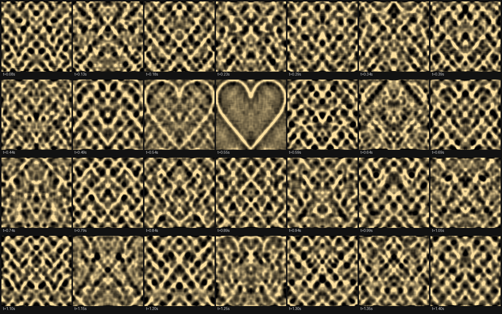

# A Message in the Ripple

> Trigger a disturbance in clear water. Its moving light patterns briefly assemble into a
> chosen symbol, then dissolve. Repeat the launch and the image returns at the same moment.

**Status: simulation-first proof of concept + hardware plan. Nothing physical has been built
yet, and feasibility on a bench is unproved.** What exists here is a differentiable forward
model of the whole chain (launch -> free water waves -> refracted light) and a three-stage
inverse design that finds a *finite* launch whose freely evolving surface paints a glyph in
caustics at a chosen instant.



*Free-running simulation. The launch imprints the surface once at t = 0; nothing is actuated
afterwards. Frames are displayed on a fixed ±25 % intensity window (no contrast stretching —
see [Honesty](#honesty-and-controls)).*

---

## The idea, stated precisely

A tray of water with a clear flat bottom sits above a matte screen; light comes from above.
The water surface is a lens whose focal structure is its curvature field, so the screen shows
caustics — the bright, moving networks you see on the bottom of a swimming pool.

The proposal: **imprint the surface once with a finite mechanical launch, then let the waves
propagate freely.** If the launch is designed correctly, the caustic pattern at one particular
instant `t*` assembles into a chosen symbol, and dispersion dissolves it again immediately.
No continuous control, no per-pixel light modulation, no shaped solid optic: the image is a
transient event carried entirely by free motion.

The question this repo exists to ask: **can a finite, buildable launch do it, or does the
inverse problem need more control than hardware can offer?**

## Headline result (in simulation)

<!--RESULTS-->
| run | actuators | corr @ t* | contrast | chi | imprint-only corr | legible window |
|---|---|---|---|---|---|---|
| heart **outline**, 32x32 actuators, 20 cm throw | 32x32 (1024) | +0.866 | 12.7% | 0.12 | +0.022 | 11 ms |
| heart **outline**, 32x32 actuators, 12 cm throw | 32x32 (1024) | +0.812 | 11.9% | 0.12 | +0.008 | 11 ms |
| filled heart, 32x32 actuators | 32x32 (1024) | +0.413 | 11.6% | 0.12 | +0.066 | 51 ms |
| filled heart, 16x16 actuators | 16x16 (256) | +0.402 | 10.2% | 0.10 | +0.059 | 51 ms |
| filled heart, 8x8 actuators | 8x8 (64) | +0.705 | 0.6% | 0.01 | -0.260 | 405 ms |
| filled heart, 8x8, contrast penalty x10 | 8x8 (64) | +0.104 | 14.8% | 0.36 | +0.142 | 557 ms |
| *(stage A reference, filled heart: no wave constraint)* | - | +0.469 | 11.9% | 9.75 | - | - |
| *(stage A reference, heart outline: no wave constraint)* | - | +0.817 | 14.4% | 11.98 | - | - |

Stage A (the same optics with the surface free to be anything, no wave dynamics) is the ceiling to compare against — a stage C row is only interesting if it approaches its own target's reference.
<!--RESULTS-->

### What the runs say

* **The reveal is produced by free motion, not by the imprint.** For the best run the caustic at
  `t = 0` — the launch's own imprint — correlates `+0.02` with the target, while the freely
  evolved surface at `t*` reaches `+0.87`. An untuned launch scores `0.00`.
* **It is fast.** Correlation stays above half its peak for **11 ms** around `t*`; the frame
  before and the frame after show unrelated caustic networks. This is the "fleeting order" the
  concept asks for — and it is a *measurement*, not a design choice. (The filled-heart target
  is slower and softer: 51 ms.)
* **A modest actuator grid is enough — but there is a floor.** 16×16 (256) actuators hold
  `corr 0.40 / 10% contrast`; 32×32 (1024) gives `0.41-0.87` depending on the target. At 8×8
  (64) the launcher can no longer express the required curvature: asked for shape alone it
  reports a flattering `corr 0.71` at **0.6 % contrast** (an invisible shimmer), and when the
  contrast requirement is enforced ten times harder it produces a visible 15 % pattern with
  `corr 0.10` — i.e. light, but not the glyph. Both halves of that failure are informative, and
  neither is hidden.
* **Throw buys fidelity at fixed visibility.** Extending the throw from 12 cm to 20 cm raised
  `corr` from 0.812 to 0.866 while contrast stayed ~12 % and `chi` stayed ~0.12: the contrast
  requirement pins the curvature budget, and the extra throw spends it on *shape* rather than
  strength.
* **The result is not a ray-sampling artifact.** `scripts/probe_sampling.py` re-renders the same
  launch from 1 to 16 rays per cell, with and without correct pixel-area integration:
  `corr 0.809 -> 0.800`, contrast `0.118 -> 0.116`. (An earlier version of this pipeline failed
  exactly this check — see the cautionary note below.)
* **Determinism.** Two evaluations of the same launch are compared bit-for-bit
  (`sha256` of the float buffer), so "repeat the launch and the image returns" holds exactly in
  the model. Physically it is a hypothesis for the bench, not a result.

## How it works

```
finite launch            initial state (eta_0, v_0)          <- bounded coarse actuator grid
    |                            |
    |                            |  linear gravity-capillary propagation, closed form in time:
    |                            |  eta(k,t) = eta_0 cos(wt) + v_0 sin(wt)/w,  w^2 = (gk + s k^3/r) tanh(kh)
    v                            v
                       surface at t*  eta(x, y, t*)
                                     |
                                     |  Snell refraction at the wavy surface + flat bottom,
                                     |  equal-flux rays splatted onto the screen
                                     v
                              screen intensity I(x, y)  ~~~ the glyph
```

Because the propagator is closed-form and the ray trace is differentiable (bilinear
splatting), the gradient of *image quality at t\** with respect to the *launch parameters*
flows through the entire chain. Three stages:

| stage | what it solves | why |
|---|---|---|
| **A. static design** | a free surface at `t*` that renders the glyph | classical computational caustics; validates the optics, gives a reference |
| **B. time reversal** | the `t = 0` state that free evolution would carry into that surface (with `v* = 0`) | existence proof for the wave-constrained problem |
| **C. constrained launch** | a bounded actuator grid optimized end-to-end through propagation + optics | the actual question: what hardware can do |

Stage B doubles as a feasibility meter. Projecting the time-reversed ideal launch onto the
actuator grid ("**reverse-and-project**") gives a cosine similarity — the fraction of the ideal
launch the hardware can express. Both grid sizes tested land above 0.8, which is the main
reason to think a bench version is worth attempting.

Theory, the focusing scaling law, and every approximation are in
[`docs/THEORY.md`](docs/THEORY.md).

## Quickstart

```bash
git clone https://github.com/BenitoJD/message-in-the-ripple
cd message-in-the-ripple
python3 -m venv .venv && .venv/bin/pip install -r requirements.txt

# physics checks first: flat water is uniform, a 1 cm dome focuses, time reversal is exact
.venv/bin/python tests/test_sanity.py

# the main experiment: optimize a finite launch, render the reveal timeline + GIF
.venv/bin/python scripts/demo_array.py --symbol "♥" --mode outline --tag outline

# other targets / finer or coarser hardware
.venv/bin/python scripts/demo_array.py --symbol "R" --mode ink --tag letter_R
.venv/bin/python scripts/demo_array.py --n-coarse 8 --tag coarse8      # 64 actuators
```

CPU-only; a full run is a few minutes. Outputs land in `results/<tag>/`:
`reveal_timeline.png` (contact sheet), `reveal.gif`, `reveal_frame_tstar.png`,
`correlation_curve.png`, `launch_imprint.png`, `launch_params.pt`, `metrics.json`.

Install gotcha (macOS): if your Python is hardened-signed (some bundled/IDE Pythons are),
PyPI's signed `torch` dylibs are rejected with *"different Team IDs"*. Use a venv from a
normal Python (Homebrew, python.org) — that is what this repo does.

## Repository map

```
ripple/                  the library
  waves.py               linear gravity-capillary propagator (closed form, differentiable)
  optics.py              Snell ray trace + bilinear splatting + area-averaged pixels
  launch.py              finite launchers: piston bed (displacement), droplet barrage (velocity)
  inverse.py             stages A/B/C: static design, time reversal, constrained launch
  targets.py             glyph -> target bitmap (any character matplotlib can draw)
  viz.py                 honest display helpers, GIF/contact sheets
scripts/
  demo_array.py          main experiment: optimize a launch, render the reveal
  demo_static.py         stage A alone (computational caustics reference)
  probe_dynamics.py      wave/curvature budgets vs time for a launch
  probe_sampling.py      how much of a rendered caustic is physics vs pixel-lattice artifact
  compare_capture.py     align a real camera capture to a simulated frame, score it
docs/
  THEORY.md              model, scaling law, approximations, falsifiable predictions
  RESEARCH_GAP.md        prior art (with links) and the gap this project targets
  HARDWARE.md            tray/light/launcher/camera plan, BOM, calibration
experiments/
  PROTOCOL.md            bench protocol, failure signatures, logging format
tests/test_sanity.py     six physics checks
results/                 committed outputs of the runs above
```

## The physics in one paragraph

For a surface slope `s`, a vertical ray leaves the water deflected by about
`(n - 1) * s` in air, so the lateral displacement at the screen is
`(n - 1) * L_eff * s` with `L_eff = gap + 0.75 * depth`. Focusing — the thing that makes a
*visible* caustic rather than a faint ripple — needs the accumulated deflection across a
feature to reach the feature size, which gives one design number:

```
chi = (n - 1) * L_eff * rms(lap(eta))        chi < 0.01  invisible ripple (~1% contrast)
                                             chi ~ 0.1-1 visible image (10-30%+ contrast)
                                             chi >> 1    speckle, then blur washes it out
```

Intensity contrast rises roughly with `chi` while `chi <~ 1` (measured here:
`chi = 0.005` -> 0.5 % contrast; `chi ~ 0.12` -> 12 %), which is why every run
reports both `contrast` and `chi` rather than correlation alone.

With a 12 cm throw, `chi ~ 1` requires `lap(eta) ~ 24 /m`: centimetre-scale ripples with
fractions of a millimetre of amplitude. That is exactly the gravity-capillary band — and it is
why big, slow, decimetre waves cannot paint a sharp image at a table-top throw, and why this
model keeps the capillary term.

### A cautionary note this repo earned the hard way

The obvious objective is Pearson correlation between the rendered caustic and the target. It
is contrast-blind. An early version of this pipeline reached `corr = 0.79` with a caustic
whose actual contrast was **0.5 %** and whose focusing parameter was `chi = 0.005` — an
invisible shimmer that only a contrast-stretching display made look like a heart.
`scripts/probe_sampling.py` is kept in the repo as the diagnostic that caught it, the loss now
carries an explicit minimum-contrast term, every run reports `contrast` and `chi` next to
`corr`, and all committed images are shown on a fixed intensity window.

## Honesty and controls

Every run reports:

* **imprint-only control** — the correlation at `t = 0`, i.e. what the launch looks like
  *before* any propagation. It must be low, otherwise "free motion made the image" is false.
* **random-launch baseline** — an untuned launch, ~0.
* **contrast and `chi`** — whether the image is physically visible at all.
* **determinism** — two evaluations of the same launch are compared bit-for-bit.
* **legible window** — how long correlation stays above half its peak, i.e. how fleeting the
  reveal is.

Not shown, not claimed: nonlinear wave effects, wall reflections (the domain is periodic),
crater/splash dynamics of real droplet impacts, source coherence, camera response, and any
physical measurement whatsoever. The list is in [`docs/THEORY.md`](docs/THEORY.md#4-what-the-model-deliberately-ignores).

## Prior art and the gap

Static caustic design is a mature field; water-wave *time reversal* has been demonstrated
experimentally (Bacot et al., *Nature Physics* 2016) but refocuses to a source rather than
painting an image; water displays either project onto water or drive it continuously. The
combination targeted here — a single finite launch, free propagation, a spatially structured
image as the target, solved inversely — is, as far as this repo's author could find, not
previously reported. Citations, the exact claim, and an invitation to correct it:
[`docs/RESEARCH_GAP.md`](docs/RESEARCH_GAP.md).

## Hardware path

[`docs/HARDWARE.md`](docs/HARDWARE.md): rig geometry, BOM (~$150-500), launcher options from
"droplet barrage from a fixed nozzle plate" to a 32×32 plunger bed, how to *see* a 50 ms event
with a $20 strobe, and the calibration order (flat field, depth, dispersion, latency).
[`experiments/PROTOCOL.md`](experiments/PROTOCOL.md): bench protocol, per-session logging,
failure signatures, and what would falsify the idea. `scripts/compare_capture.py` already
scores a real capture against the simulation.

## Roadmap

* **Staggered launches.** Give each actuator its own fire time (a few ms apart) — a cheap new
  degree of freedom that water displays have and this model does not yet use.
* **Nonlinear validation.** Re-run the designed launches in a high-order spectral (HOS) model
  to find where linear design breaks (steepness is already reported per run).
* **Absorbing boundaries** instead of a periodic domain, to widen the usable time window.
* **Launcher-constrained design.** Quantized drop volumes, a fixed nozzle count, restricted
  patterns — solve for what is buildable, not for what is ideal.
* **Build it.** Start with the coarse launcher, verify the dispersion measurement, and score
  captures with `compare_capture.py`.
* **Sequences.** Several reveals from one launch (dispersion gives recurrences) or successive
  glyphs spelling a word.

## License and citation

MIT — see [`LICENSE`](LICENSE). If you build on this, cite the repository
([`CITATION.cff`](CITATION.cff)) and please open an issue with what you find; the honest status
of the idea is *unproved and possibly already done by someone we failed to find*.
